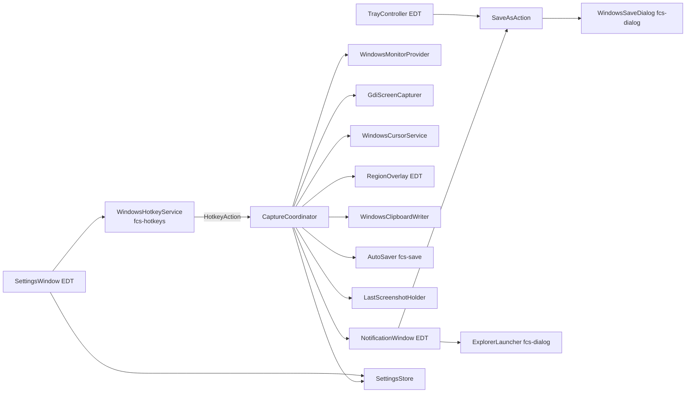

# TDD-001: Захват экрана (3 режима), буфер обмена, автосохранение, «Сохранить как», настройки — v1 для Windows

| Поле | Значение |
|---|---|
| Статус | Review |
| Автор | Tech |
| Дата | 2026-10-18 |
| Входные артефакты | REQ-001, US-001 – US-007, RES-001 |
| ADR | ADR-001, ADR-002, ADR-003 |
| Задачи | TASK-001 – TASK-019 |

## 1. Цель и рамки

- **Цель:** создать с нуля проект (Gradle, Kotlin 2.4, JDK 25, Compose Desktop) и реализовать REQ-001: три режима
  захвата по глобальным горячим клавишам в физических пикселях, автокопирование в буфер обмена, атомарное
  автосохранение PNG, «Сохранить как…», уведомления на 3 с, трей, окно настроек и дистрибутив app-image.
- **Входит:** все Must и Should требования REQ-001; Could: REQ-001.35 (отключение автосохранения), REQ-001.48 (кнопка
  «Сбросить»), REQ-001.51 (частично — см. §15).
- **Не входит:** REQ-001.56, .57, .58 (Won't v1); macOS/Linux; одновременный запуск нескольких экземпляров (не описан
  в требованиях — §17); автозапуск с Windows.

## 2. Трассировка требований

| Требование / AC | Суть | Компонент(ы) | Задача(и) | Как проверяется |
|---|---|---|---|---|
| REQ-001.1, .52 | 3 режима, клавиши по умолчанию | `HotkeySettings`, `CaptureCoordinator` | TASK-004, 010 | unit + ручная |
| REQ-001.2 | Глобальные клавиши в фоне | `WindowsHotkeyService`, `NativeMessageLoop` | TASK-007 | ручная |
| REQ-001.3 | Уведомление о конфликте клавиши | `WindowsHotkeyService`, `FastCowScreenshotApp` | TASK-007, 015 | ручная |
| REQ-001.4 | Переназначение клавиш | `SettingsWindow`, `HotkeyBinding` | TASK-004, 014 | unit + ручная |
| REQ-001.5 | Игнор повторных нажатий | `CaptureCoordinator` (флаг `busy`) | TASK-010 | unit |
| REQ-001.6, .8 | Монитор под курсором, fallback на primary | `WindowsMonitorProvider` | TASK-006 | ручная + integration |
| REQ-001.7, .9, .10, .19, .20, N5 | Физические пиксели, раскладка, отрицательные координаты | `VirtualDesktop`, `GdiScreenCapturer`, `DpiAwareness` | TASK-002, 005, 006 | unit + ручная |
| REQ-001.11 | Серый `#808080` в пустых зонах | `GdiScreenCapturer` | TASK-006 | unit (geometry) + ручная |
| REQ-001.12 | Дублирование мониторов — один раз | `WindowsMonitorProvider` (`EnumDisplayMonitors` даёт один HMONITOR на клон) | TASK-006 | ручная |
| REQ-001.13–.18 | Замороженный кадр, выделение, размер, отмена, < 2×2 | `RegionOverlay`, `SelectionGeometry`, `CaptureCoordinator` | TASK-002, 010, 013 | unit + ручная |
| REQ-001.21 | Свои окна не в снимке | `WindowHandles.excludeFromCapture` | TASK-005, 011, 014 | ручная |
| REQ-001.22, .53 | Указатель выкл/вкл | `WindowsCursorService`, `CaptureCoordinator` | TASK-006, 010 | unit + ручная |
| REQ-001.23, .26 | Буфер CF_DIB, остаётся после выхода | `DibEncoder`, `WindowsClipboardWriter` | TASK-008 | unit + ручная |
| REQ-001.24 | Буфер и сохранение независимы | `CaptureCoordinator` | TASK-010 | unit |
| REQ-001.25 | 8 попыток за 700 мс, текст ошибки | `WindowsClipboardWriter` | TASK-008 | unit (`ClipboardRetry`) |
| REQ-001.27–.30, .32 | PNG, имя, суффикс, создание папок, атомарность | `ScreenshotFileNames`, `AutoSaver`, `PngFileWriter` | TASK-003, 009 | unit |
| REQ-001.31 | Ошибка записи → причина + «Сохранить как…» | `AutoSaver`, `NotificationWindow` | TASK-009, 011 | unit + ручная |
| REQ-001.33 | Асинхронное сохранение | поток `fcs-save` | TASK-010 | unit |
| REQ-001.34, .54, N12 | Уведомление 3 с, замена, клик → Проводник | `NotificationWindow`, `ExplorerLauncher` | TASK-011 | ручная |
| REQ-001.35 | Отключение автосохранения | `AppSettings.autoSaveEnabled`, `SettingsWindow` | TASK-004, 010, 014 | unit + ручная |
| REQ-001.36, .37, .42 | Последний снимок, пункт трея | `LastScreenshotHolder`, `TrayController` | TASK-010, 015 | unit + ручная |
| REQ-001.38–.41, .55 | Диалог «Сохранить как», `.png`, перезапись, последняя папка | `SaveAsAction`, `WindowsSaveDialog`, `SaveAsFileName` | TASK-003, 012 | unit + ручная |
| REQ-001.43–.48 | Директория по умолчанию: выбор, проверка, сброс | `SettingsWindow`, `WindowsFolderDialog`, `KnownFolders`, `DirectoryValidator` | TASK-009, 014 | unit + ручная |
| REQ-001.49, .50 | Кириллица, пробелы, UNC | NIO + `…W`-функции | TASK-009 | unit (кириллица) + ручная (UNC) |
| REQ-001.N1–N4 | Время | §13 | TASK-006, 008, 009, 013 | замер (лог `INFO … in N ms`) |
| REQ-001.N6, N7 | Память | §13 | TASK-016 | замер вручную |
| REQ-001.N8 | Win10 22H2 / Win11 | весь код | TASK-016 | ручная |
| REQ-001.N11 | Смена конфигурации мониторов | `MonitorProvider.desktop()` вызывается при каждом захвате | TASK-006, 010 | ручная |

## 3. Принятые технические решения

| Вопрос | Решение | Альтернативы | Обоснование / ADR |
|---|---|---|---|
| Стек | Kotlin 2.4.21, JDK 25, Gradle 9.8.1 | JDK 21 | ADR-001 (выбор пользователя) |
| UI | Compose Desktop 1.12.2 + Material; оверлей — Swing/Java2D; трей — AWT | TornadoFX, Swing, JavaFX | ADR-001 |
| WinAPI | JNA 5.19.1 | JNI, Panama | ADR-002 |
| Захват | GDI `BitBlt` всей нужной области за один вызов, копирование только прямоугольников мониторов поверх серого фона | Robot, DXGI | ADR-002, RES-001 |
| Координаты мыши в оверлее | `GetCursorPos` (физические), а не координаты `MouseEvent` (логические, с потерей точности при 125/150 %) | `MouseEvent.x * scale` | REQ-001.19 |
| Буфер обмена | Свой `CF_DIB` 24 бит bottom-up; без PNG-формата (кодирование PNG не укладывается в N1) | AWT Clipboard | ADR-002 |
| Повторы буфера | 8 попыток `OpenClipboard`, пауза 100 мс (7 пауз = 700 мс ≤ 1 с) | — | REQ-001.25 |
| Настройки | JSON `%APPDATA%\fast-cow-screenshot\settings.json` | properties, prefs | ADR-003 |
| Потоки | 4 однопоточных executor + поток цикла сообщений | coroutines | §7 |
| Уведомление | `JWindow` + `ComposePanel`, неактивируемое, 3000 мс, одно окно переиспользуется | toast | REQ-001.54, RES-001 §3a |
| Допустимые клавиши для переназначения | Ctrl и/или Alt (+Shift необязательно) + `A–Z`, `0–9`, `F1–F12` | любые | ограничение `RegisterHotKey`; **Допущение** §17 |

## 4. Архитектура

### 4.1. Компоненты



| Компонент | Пакет / файл | Ответственность | Поток | Задача |
|---|---|---|---|---|
| `PixelRect`, `PixelPoint`, `MonitorInfo`, `VirtualDesktop`, `SelectionGeometry`, `CaptureMode`, `Screenshot` | `domain` | Геометрия и модели | любой | TASK-002 |
| `ScreenshotFileNames`, `SaveAsFileName`, `TextEllipsis` | `domain` | Имена файлов, сокращение пути | любой | TASK-003 |
| `AppSettings`, `HotkeySettings`, `HotkeyAction`, `HotkeyBinding`, `SettingsRepository`, `SettingsStore`, `DefaultDirectoryProvider` | `settings` | Настройки | любой (`SettingsStore` потокобезопасен) | TASK-004 |
| `User32Api`, `Gdi32Api`, `Kernel32Api`, `Shell32Api`, `Comdlg32Api`, `CURSORINFO`, `OPENFILENAME`, `BROWSEINFO`, `WinConst` | `platform.windows.jna` | Маппинги | — | TASK-005 |
| `WinApiException`, `DpiAwareness`, `WindowHandles` | `platform.windows` | Общие утилиты | см. KDoc | TASK-005 |
| `WindowsMonitorProvider`, `GdiScreenCapturer`, `WindowsCursorService` | `platform.windows` | Мониторы, захват, указатель | `fcs-capture` | TASK-006 |
| `NativeMessageLoop`, `WindowsHotkeyService` | `platform.windows` | Горячие клавиши, окно-владелец буфера | `fcs-hotkeys` | TASK-007 |
| `DibEncoder`, `ClipboardRetry`, `WindowsClipboardWriter` | `platform.windows` | Буфер обмена | `fcs-capture` | TASK-008 |
| `PngFileWriter`, `AutoSaver`, `ScreenshotSaver`, `SaveResult`, `IoErrorMessages`, `DirectoryValidator` | `storage` | Запись файлов | `fcs-save`, `fcs-dialog` | TASK-009 |
| `KnownFolders` | `platform.windows` | `FOLDERID_Screenshots` / `FOLDERID_Pictures` | любой | TASK-009 |
| Интерфейсы `MonitorProvider`, `ScreenCapturer`, `CursorService`, `CursorSnapshot`, `ClipboardWriter`, `ClipboardResult`, `RegionSelector`, `CaptureNotifier`, `HotkeyService`, `CaptureException`, `CaptureOutcome` | `capture` | Контракты | — | TASK-002 (часть), TASK-006–010 |
| `CaptureCoordinator`, `LastScreenshotHolder` | `capture` | Сценарии захвата | `fcs-capture`/`fcs-save`/EDT | TASK-010 |
| `AppThreads` | `app` | Потоки | — | TASK-010 |
| `NotificationWindow`, `NotificationContent` | `ui` | Уведомления | EDT | TASK-011 |
| `ExplorerLauncher` | `platform.windows` | Открыть папку с выделенным файлом | `fcs-dialog` | TASK-011 |
| `WindowsSaveDialog`, `WindowsMessageBox`, `SaveAsAction` | `platform.windows`, `ui` | «Сохранить как…» | `fcs-dialog` | TASK-012 |
| `RegionOverlay`, `SelectionState` | `ui` | Оверлей выделения | EDT | TASK-013 |
| `WindowsFolderDialog`, `SettingsWindow`, `HotkeyRecorder` | `platform.windows`, `ui` | Окно настроек | EDT + `fcs-dialog` | TASK-014 |
| `TrayController`, `TrayIconImage`, `FastCowScreenshotApp`, `Main.kt` | `ui`, `app` | Трей, сборка, запуск, выход | EDT | TASK-015 |

### 4.2. Правила зависимостей

`domain` ← `settings` ← `storage` ← `capture` ← `platform.windows` / `ui` ← `app`. `capture` знает только интерфейсы;
реализации на WinAPI подставляет `FastCowScreenshotApp`. Подробнее — `conventions.md` §3.

## 5. Контракты

Полные сигнатуры приведены в задачах; здесь — сводка межмодульных интерфейсов (пакет `by.sparkyanvil.fastcowscreenshot`).

```kotlin
// domain
internal data class PixelPoint(val x: Int, val y: Int)
internal data class PixelRect(val left: Int, val top: Int, val width: Int, val height: Int) // right/bottom — исключительные
internal data class MonitorInfo(val deviceName: String, val bounds: PixelRect, val workArea: PixelRect, val isPrimary: Boolean)
internal data class VirtualDesktop(val monitors: List<MonitorInfo>) // bounds, primary, monitorAt(point)
internal enum class CaptureMode { MONITOR_UNDER_CURSOR, ALL_MONITORS, REGION }
internal data class Screenshot(val image: BufferedImage, val capturedAt: LocalDateTime, val mode: CaptureMode)

// capture
internal interface MonitorProvider { fun desktop(): VirtualDesktop; fun monitorUnderCursor(desktop: VirtualDesktop): MonitorInfo }
internal interface ScreenCapturer { fun capture(area: PixelRect, desktop: VirtualDesktop): BufferedImage }
internal interface CursorSnapshot : AutoCloseable { val hotspot: PixelPoint }
internal interface CursorService { fun snapshot(): CursorSnapshot?; fun paint(image: BufferedImage, cursor: CursorSnapshot, imageOrigin: PixelPoint) }
internal sealed interface ClipboardResult { data object Success : ClipboardResult; data class Failure(val reason: String) : ClipboardResult }
internal interface ClipboardWriter { fun write(image: BufferedImage): ClipboardResult }
internal interface RegionSelector { fun select(frame: BufferedImage, desktop: VirtualDesktop, onResult: (PixelRect?) -> Unit) }
internal data class CaptureOutcome(val screenshot: Screenshot, val clipboard: ClipboardResult, val save: SaveResult?)
internal interface CaptureNotifier { fun showOutcome(outcome: CaptureOutcome); fun showMessage(title: String, lines: List<String>) }
internal interface HotkeyService { fun start(onHotkey: (HotkeyAction) -> Unit); fun register(action: HotkeyAction, binding: HotkeyBinding): Boolean; fun stop() }

// storage (ScreenshotSaver лежит в storage, чтобы storage не зависел от capture)
internal interface ScreenshotSaver { fun save(image: BufferedImage, capturedAt: LocalDateTime, directory: Path): SaveResult }
internal sealed interface SaveResult { data class Saved(val file: Path) : SaveResult; data class Failed(val directory: Path, val reason: String) : SaveResult }
```

## 6. Сценарии и потоки данных

### 6.1. «Монитор под курсором» / «Все мониторы»

```mermaid
sequenceDiagram
    participant H as fcs-hotkeys
    participant C as CaptureCoordinator
    participant K as fcs-capture
    participant S as fcs-save
    participant U as EDT
    H->>C: trigger(MONITOR_UNDER_CURSOR)
    C->>C: busy.compareAndSet(false,true) (иначе return false)
    C->>K: execute
    K->>K: cursor = includeCursor ? snapshot() : null
    K->>K: desktop(); area = monitorUnderCursor(desktop).bounds | desktop.bounds
    K->>K: image = capture(area, desktop); paint(cursor) если внутри area
    K->>K: clipboard = write(image)
    K->>C: lastScreenshot.set; busy=false
    K->>S: execute save (если autoSaveEnabled)
    S->>U: notifier.showOutcome(outcome)
```

### 6.2. «Область»

1. `fcs-capture`: снимок указателя (если включён), `desktop()`, `frame = capture(desktop.bounds, desktop)`.
2. EDT: `regionSelector.select(frame, desktop) { rect -> … }`. Оверлей рисует `frame` 1:1.
3. `rect == null` (Esc, ПКМ, < 2×2) → `busy = false`, буфер и файлы не меняются (REQ-001.17, .18).
4. Иначе `fcs-capture`: `image = copy(frame, rect − desktop.bounds.origin)`, указатель рисуется, если `rect.contains(hotspot)`,
   далее как 6.1 с шага clipboard.

### 6.3. «Сохранить как…»

EDT (трей/уведомление) → `SaveAsAction.run()` → `fcs-dialog`: снимок из `LastScreenshotHolder` фиксируется в момент
вызова → `GetSaveFileNameW` → `SaveAsFileName.normalize` → если существует, `MessageBoxW` «Да/Нет» →
`PngFileWriter.writeAtomically(replaceExisting = true)` → `settings.lastSaveAsDirectory = parent`.

## 7. Многопоточность и состояние

- Потоки: `fcs-capture`, `fcs-save`, `fcs-dialog` (однопоточные `ExecutorService`, daemon), EDT, `fcs-hotkeys`.
- `CaptureCoordinator.busy: AtomicBoolean` — единственная защита от повторов (REQ-001.5). Снимается после записи в буфер
  (захват 1/2) или после отмены/записи в буфер (режим 3). Сохранение в файл идёт уже после снятия флага (REQ-001.33).
- `LastScreenshotHolder` — `AtomicReference<Screenshot?>`; слушатели вызываются через `uiExecutor`.
- `SettingsStore` — `@Volatile current` + `synchronized(update)`.
- Выход: `FastCowScreenshotApp.exit()` на EDT → `hotkeys.stop()` → `AppThreads.shutdown(5000 мс)` → удалить трей →
  `System.exit(0)`.

### 7.1. Состояния координатора

| Состояние | Событие | Новое состояние | Действие |
|---|---|---|---|
| `Idle` | `trigger(mode)` | `Busy` | запуск захвата |
| `Busy` | `trigger(mode)` | `Busy` | `return false`, `DEBUG "Hotkey ignored: capture in progress"` |
| `Busy` | буфер записан / отмена / ошибка захвата | `Idle` | `busy.set(false)` |

## 8. Алгоритмы и формулы

**Ограничивающий прямоугольник:** `left = min(m.left)`, `top = min(m.top)`, `right = max(m.right)`, `bottom = max(m.bottom)`.

**Пример (US-002 AC-1):** A = (0, 0, 1920×1080, primary), B слева = (−2560, 0, 2560×1440) →
bounds = (−2560, 0, 4480×1440). B в изображении: x 0..2559, y 0..1439. A: x 2560..4479, y 0..1079.
Серый: x 2560..4479, y 1080..1439 = 1920×360 (US-002 AC-2).

**Выделение:** точки A(ax, ay) и B(bx, by) — физические пиксели, включительно:
`left = min(ax,bx)`, `top = min(ay,by)`, `width = |ax−bx| + 1`, `height = |ay−by| + 1`. Отмена, если `width < 2` или `height < 2`.
Пример: A = (1900, 500), B = (1700, 300) → (1700, 300, 201×201). Клик A = B → 1×1 → отмена.

**Перевод в координаты кадра:** `imageRect = rect.translate(−desktop.bounds.left, −desktop.bounds.top)`.
Пример: bounds.left = −2560, rect.left = −100 → x в кадре = 2460.

## 9. Обработка ошибок

| Ситуация | Где обнаруживается | Поведение системы | Лог | Что видит пользователь |
|---|---|---|---|---|
| Клавиша занята | `WindowsHotkeyService.register` → `false` | Остальные регистрируются | `WARN "RegisterHotKey failed for {}: {}, GetLastError={}"` | Уведомление «Горячие клавиши недоступны» + строки (TASK-015) |
| Ошибка WinAPI при захвате | `GdiScreenCapturer` → `CaptureException` | `busy=false`, снимок не создаётся | `ERROR "Capture failed"` + стек | «Не удалось сделать снимок» / сообщение исключения |
| Буфер занят 8 раз | `WindowsClipboardWriter` | Файл сохраняется | `WARN "Clipboard busy, attempt {}/8"`, `ERROR "Clipboard write failed: {}"` | «Не удалось скопировать в буфер обмена» |
| Ошибка записи файла | `AutoSaver` → `SaveResult.Failed` | Снимок остаётся в буфере и в `LastScreenshotHolder` | `ERROR "Auto-save failed in {}: {}"` | «Не удалось сохранить снимок» + причина + кнопка «Сохранить как…» |
| Повреждён `settings.json` | `SettingsRepository.load` | Значения по умолчанию | `WARN "Settings file is corrupted, defaults used"` | — |
| Монитор отключён во время оверлея | `RegionOverlay` (исключение при отрисовке/позиционировании) | Оверлей закрывается как отмена | `WARN "Overlay closed: {}"` | — |

## 10. Конфигурация, константы и тексты UI

| Имя | Тип | Значение | Где объявлена | Требование |
|---|---|---|---|---|
| `GAP_FILL_RGB` | `Int` | `0x808080` | `domain/ImageConstants.kt` | REQ-001.11 |
| `SelectionGeometry.MIN_SIZE` | `Int` | `2` | `domain/SelectionGeometry.kt` | REQ-001.18 |
| `ClipboardRetry.MAX_ATTEMPTS` / `DELAY_MS` | `Int` / `Long` | `8` / `100` | `platform/windows/ClipboardRetry.kt` | REQ-001.25 |
| `NotificationWindow.DISPLAY_MS` | `Int` | `3000` | `ui/NotificationWindow.kt` | REQ-001.54 |
| Имя файла | — | `Screenshot_yyyy-MM-dd_HH-mm-ss[_N].png` | `domain/ScreenshotFileNames.kt` | REQ-001.28, .29 |

Тексты UI (дословно) — в задачах TASK-011, 012, 014, 015.

## 11. Хранение данных и форматы

`%APPDATA%\fast-cow-screenshot\settings.json` (UTF-8):

```json
{
  "version": 1,
  "defaultDirectory": "C:\\Users\\Александр\\Pictures\\Screenshots",
  "lastSaveAsDirectory": null,
  "includeCursor": false,
  "autoSaveEnabled": true,
  "hotkeys": { "monitorUnderCursor": "Ctrl+Shift+1", "allMonitors": "Ctrl+Shift+2", "region": "Ctrl+Shift+3" }
}
```

Нет файла → значения по умолчанию, `defaultDirectory` из `KnownFolders` (REQ-001.44), файл записывается. Неизвестные
ключи игнорируются. Миграций в v1 нет.

## 12. Логирование

Конфиг — `src/main/resources/logback.xml` (TASK-001). Обязательные события: старт (`INFO "fast-cow-screenshot started, java {}"`),
DPI awareness EDT и `fcs-capture`, регистрация каждой клавиши, каждый захват (режим, размер, длительность до буфера в мс),
сохранённый файл (путь), длительность сохранения, ошибки по §9, выход.

## 13. Производительность и ресурсы

| NFR | Как достигается | Как измеряется |
|---|---|---|
| N1 ≤ 300 мс | Один `BitBlt`, `Pointer.read` в `int[]`, DIB 24 бит без PNG | лог `Captured … in N ms` (от `trigger` до записи в буфер) |
| N2 ≤ 700 мс | То же; копирование только прямоугольников мониторов | тот же лог, 3 × 4K |
| N3 ≤ 250 мс | Оверлей на Java2D, рисует кадр без копирования | лог `Overlay shown in N ms` |
| N4 ≤ 1,5 с | `ImageIO`, `compressionQuality = 0.5f` (deflate 4), `TYPE_INT_RGB` | лог `Saved {} in N ms` |
| N6 heap ≤ 400 МБ | `-Xmx768m`; один кадр в памяти + одна DIB-копия при записи в буфер | VisualVM / Диспетчер задач, TASK-016 |
| N7 | Освобождение GDI/HGLOBAL в `finally` | 1000 захватов, TASK-016 |

## 14. Стратегия тестирования

| Уровень | Что проверяется | Инструменты | Задачи |
|---|---|---|---|
| Unit | Геометрия, имена файлов, настройки, DIB, повторы, автосохранение, координатор (фейки) | JUnit 6, kotlin-test, MockK, `@TempDir` | 002–004, 008–010, 013 |
| Интеграционный (Windows) | Загрузка JNA, перечисление мониторов, захват primary | `@EnabledOnOs(OS.WINDOWS)` | 005, 006 |
| Ручной | Мультимонитор, HiDPI, клавиши, трей, вставка в Paint/Word/Telegram/Chrome, уведомления | Чек-листы в задачах | 006, 008, 011–016 |

## 15. Риски

| Риск | Вероятность | Влияние | Митигация |
|---|---|---|---|
| AWT/Skia не выставили per-monitor DPI процессу | Низкая | Высокое | Поток захвата сам входит в V2; EDT-awareness логируется при старте |
| WM_DPICHANGED меняет размер окна оверлея | Средняя | Высокое | Двойной `SetWindowPos` + проверка `GetWindowRect` (TASK-013) |
| N3 не выполняется при первом показе | Средняя | Среднее | Замер; при нарушении — CLR к Tech |
| Skia повышает RSS > 200 МБ (N6) | Средняя | Среднее | Замер в TASK-016 |
| G1 не возвращает committed heap ОС после снимков: RSS 438–646 МБ при heap used 27 МБ | Произошёл | Высокое | Флаги `G1PeriodicGCInterval`, `Min/MaxHeapFreeRatio` (TASK-019, CLR-005); если не хватит — уточнение N6 у Analyst |
| JDK без `jmods` (JEP 493) не включает `jdk.jlink` в образ | Произошёл | Высокое | Явный список `modules(...)` (TASK-018, CLR-004) |
| `SHBrowseForFolderW` — пути ≤ 260 символов | Высокая | Низкое | REQ-001.51 Could; NIO работает с длинными путями |
| Excel и др. теряют `Ctrl+Shift+1/2/3` | Высокая | Низкое | Переназначение (TASK-014) |
| Меню трея (AWT `PopupMenu`) при ПКМ частично перекрывается панелью задач | Средняя | Низкое | Известное ограничение v1, принято (CLR-003); замена меню — вне v1 |
| `KeyEvent.nativeKeyEvent` в Compose — не `java.awt.event.KeyEvent` | Произошёл | Высокое | `e.key.nativeKeyCode` + чистая функция `HotkeyRecorder.onKeyDown` (TASK-017, CLR-003) |

## 16. План задач

| Порядок | Задача | Название | Зависит от | Оценка |
|---|---|---|---|---|
| 1 | TASK-001 | Каркас Gradle-проекта | — | M |
| 2 | TASK-002 | Доменная геометрия и модели | 001 | M |
| 3 | TASK-003 | Имена файлов и сокращение пути | 001 | S |
| 4 | TASK-004 | Модель настроек и JSON-хранилище | 002 | M |
| 5 | TASK-005 | JNA-маппинги WinAPI, DPI, HWND окон | 001 | L |
| 6 | TASK-006 | Мониторы, GDI-захват, указатель мыши | 002, 005 | L |
| 7 | TASK-007 | Цикл сообщений и глобальные горячие клавиши | 004, 005 | M |
| 8 | TASK-008 | Запись в буфер обмена (CF_DIB) | 005, 006, 007 | M |
| 9 | TASK-009 | Автосохранение PNG и Known Folders | 003, 004, 005 | M |
| 10 | TASK-010 | Координатор захвата и потоки приложения | 006, 008, 009 | L |
| 11 | TASK-011 | Окно уведомлений | 003, 005, 010 | M |
| 12 | TASK-012 | «Сохранить как…» | 003, 004, 005, 009, 010 | M |
| 13 | TASK-013 | Оверлей выделения области | 002, 005, 010 | L |
| 14 | TASK-014 | Окно настроек | 004, 005, 007, 009, 010, 011 | L |
| 14a | TASK-017 | Исправление записи сочетания клавиш (CLR-003) | 014 | S |
| 15a | TASK-018 | Явный список модулей runtime (CLR-004) | 015 | S |
| 15 | TASK-015 | Трей, сборка приложения, запуск и выход | 011, 012, 013, 014, 017 | M |
| 15b | TASK-019 | Флаги G1 для возврата памяти ОС, замер RSS (CLR-005) | 018 | S |
| 16 | TASK-016 | Дистрибутив app-image и приёмочные замеры | 015, 018, 019 | S |

## 17. Допущения и открытые вопросы

- **Допущение:** при переназначении допустимы только сочетания с Ctrl и/или Alt (Shift — необязательно) и клавишей
  `A–Z`, `0–9`, `F1–F12`. Сочетания с Win не поддерживаются. Это техническое ограничение; пользователь может его расширить.
- **Допущение:** уведомление объединяет результат буфера и сохранения и показывается один раз после завершения
  сохранения (N12). Тексты комбинаций — TASK-011.
- **Допущение:** «Сохранить как…» сохраняет снимок, который был последним в момент вызова (US-006, граничный случай).
- **Допущение (CLR-005, решение пользователя):** приёмка NFR выполняется на стенде Windows 11, 1 монитор 3440×1440.
  N2, N6 heap на 3 × 4K и N8 (Windows 10 22H2) отложены до появления эталонного стенда; v1 они не блокируют.
- [ ] Второй экземпляр приложения: сейчас он покажет конфликт всех трёх клавиш. Нужно ли запрещать второй запуск —
  вопрос к **Analyst**, на v1 не влияет.
- [ ] Некритичные вопросы REQ-001 §8 (оттенок серого, длительность уведомлений об ошибках, монитор уведомления) приняты
  по умолчанию Analyst.
