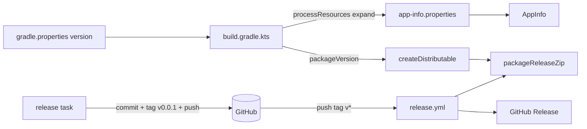

# TDD-002: Процесс релиза и выпуск версии 0.0.1

| Поле | Значение |
|---|---|
| Статус | Review |
| Автор | Tech |
| Дата | 2026-10-31 |
| Входные артефакты | Запрос пользователя «настроить релиз-плагин и выпустить версию 0.0.1»; ADR-001; TDD-001 (TASK-016, TASK-018) |
| ADR | ADR-004 |
| Задачи | TASK-020 – TASK-022 |

## 1. Цель и рамки

- **Цель:** единый источник версии (`gradle.properties`), релиз через `net.researchgate.release`, сборка ZIP
  app-image и публикация GitHub Release в GitHub Actions по тегу; выпуск `0.0.1`.
- **Входит:** версия в `gradle.properties`; `AppInfo.VERSION` из ресурса, заполняемого Gradle; `packageVersion` из
  версии проекта; задача `packageReleaseZip`; плагин релиза; workflow `.github/workflows/release.yml`; выполнение
  релиза `0.0.1`.
- **Не входит:** MSI/EXE-установщики, подпись кода, CHANGELOG, публикация в Maven, CI на pull request, автообновление.

## 2. Трассировка требований

REQ от Analyst для релиза нет; источник — запрос пользователя и ADR-004.

| Требование | Суть | Компонент(ы) | Задача | Как проверяется |
|---|---|---|---|---|
| ADR-004 / версия | Одна точка правды о версии | `gradle.properties`, `AppInfo`, `build.gradle.kts` | TASK-020 | unit-тест `AppInfoTest`, лог запуска |
| ADR-004 / плагин | `release` создаёт тег `v<version>` с `main` | `build.gradle.kts` (`ReleaseExtension`) | TASK-020, TASK-022 | `git tag` после релиза |
| ADR-004 / артефакт | ZIP app-image | задача `packageReleaseZip` | TASK-020 | файл в `build\release\` |
| ADR-004 / CI | GitHub Release по тегу | `.github/workflows/release.yml` | TASK-021, TASK-022 | страница Releases |
| Запрос | Версия 0.0.1 выпущена | — | TASK-022 | Release `v0.0.1` с ZIP |

## 3. Принятые технические решения

| Вопрос | Решение | Альтернативы | Обоснование |
|---|---|---|---|
| Плагин релиза | `net.researchgate.release` 3.2.0 | axion-release, вручную | ADR-004 |
| Хранение версии | `version=` в `gradle.properties` | `build.gradle.kts` | Плагин правит `gradle.properties` |
| Формат тега | `v${version}` | `${version}` | Триггер workflow `v*` |
| Версия в коде | ресурс `app-info.properties` с подстановкой `${version}` в `processResources` | генерация Kotlin-исходника; `Implementation-Version` манифеста | Работает и в `run`, и в app-image, без плагинов |
| `packageVersion` | `version` без `-SNAPSHOT` | отдельное свойство | jpackage не принимает суффиксы |
| Артефакт | `build/release/fast-cow-screenshot-<v>-windows-x64.zip`, внутри папка `FastCScreen/` с `FastCScreen.exe` | MSI | ADR-004 |
| Имя exe | `packageName = "FastCScreen"` (решение пользователя); `rootProject.name`, `AppInfo.NAME`, каталоги данных и имя ZIP — `fast-cow-screenshot` | переименовать всё | Не терять настройки и логи; минимальный объём изменений |
| CI | `windows-latest`, `actions/checkout@v7`, `actions/setup-java@v6` (temurin 25), `gradle/actions/setup-gradle@v6`, `softprops/action-gh-release@v3` | локальная публикация | ADR-004; версии проверены 2026-10-31 |
| Тесты в CI | не запускаются; запускает локальный `release` (`build`) | `build` в CI | WinAPI-тесты требуют рабочего стола |

## 4. Архитектура

### 4.1. Компоненты



| Компонент | Файл | Ответственность |
|---|---|---|
| Версия | `gradle.properties` | `version=0.0.1-SNAPSHOT` |
| `AppInfo` | `src/main/kotlin/by/sparkyanvil/fastcowscreenshot/AppInfo.kt` | Читает версию из `/app-info.properties` |
| Ресурс | `src/main/resources/app-info.properties` | `version=${version}` (подставляет Gradle) |
| Релиз | `build.gradle.kts` (`ReleaseExtension`) | тег `v…`, ветка `main` |
| ZIP | `build.gradle.kts` (`packageReleaseZip`) | архив app-image |
| CI | `.github/workflows/release.yml` | сборка ZIP и Release по тегу |

### 4.2. Правила зависимостей

`AppInfo` — только JDK (`java.util.Properties`). Плагин релиза — зависимость сборки, не runtime.

## 5. Контракты

```kotlin
package by.sparkyanvil.fastcowscreenshot

internal object AppInfo {
    const val NAME: String = "fast-cow-screenshot"
    val VERSION: String // из /app-info.properties, бросает IllegalStateException при отсутствии
    internal fun parseVersion(input: java.io.InputStream?): String
}
```

Gradle-задача: `packageReleaseZip` (тип `Zip`, группа `distribution`), зависит от `createDistributable`.

## 6. Сценарии

### 6.1. Выпуск версии

1. Разработчик на `main` (дерево чистое, синхронизировано с `origin/main`) запускает
   `.\gradlew.bat release "-Prelease.useAutomaticVersion=true" "-Prelease.releaseVersion=0.0.1" "-Prelease.newVersion=0.0.2-SNAPSHOT"`.
2. Плагин: проверки → `version=0.0.1` → `build` → коммит с сообщением, начинающимся с `[Gradle Release Plugin] - pre tag commit:` →
   тег `v0.0.1` → `version=0.0.2-SNAPSHOT` → коммит → push коммитов и тега в `origin`.
3. GitHub Actions по тегу: проверка тег == `gradle.properties` → `packageReleaseZip` → Release `v0.0.1` с ZIP.

## 7. Многопоточность и состояние

Н/П — изменения сборки; `AppInfo.VERSION` инициализируется один раз при загрузке объекта (потокобезопасно по JVM).

## 8. Алгоритмы

`packageVersion = version.removeSuffix("-SNAPSHOT")`. Пример: `0.0.2-SNAPSHOT` → `0.0.2`; `0.0.1` → `0.0.1`.
Проверка в CI: `github.ref_name = "v0.0.1"` → `TrimStart('v')` → `0.0.1`; сравнить с `version=` из `gradle.properties`.

## 9. Обработка ошибок

| Ситуация | Где | Поведение | Что видит пользователь |
|---|---|---|---|
| Ресурса `app-info.properties` нет или `version` пустая | `AppInfo` | `IllegalStateException("app-info.properties: version is missing")` при старте | Приложение не запускается, стек в консоли |
| Грязное дерево / неотправленные коммиты / не `main` | плагин | `release` падает, изменения откатываются (`revertOnFail`) | Сообщение плагина в консоли |
| Тег ≠ версии в `gradle.properties` | workflow | job падает до сборки | Красный job, текст `Tag version X != gradle.properties version Y` |
| ZIP не найден | `action-gh-release` (`fail_on_unmatched_files: true`) | job падает | Красный job |

## 10. Константы

| Имя | Значение | Где |
|---|---|---|
| Тег | `v${version}` | `build.gradle.kts` |
| Релизная ветка | `main` | `build.gradle.kts` |
| Имя ZIP | `fast-cow-screenshot-<version>-windows-x64.zip` | `build.gradle.kts` |
| Каталог ZIP | `build/release` | `build.gradle.kts` |

## 11. Хранение данных и форматы

`src/main/resources/app-info.properties`: одна строка `version=${version}`; после `processResources` —
`version=0.0.1-SNAPSHOT` (или релизная).

## 12. Логирование

Без изменений: `Main.kt` уже пишет `"{} {} started, java {}"` с `AppInfo.VERSION`.

## 13. Производительность и ресурсы

Н/П — чтение одного маленького ресурса при старте.

## 14. Стратегия тестирования

| Уровень | Что | Задачи |
|---|---|---|
| Unit | `AppInfo.parseVersion`, формат `AppInfo.VERSION` | TASK-020 |
| Сборка | `packageReleaseZip` создаёт ZIP с exe | TASK-020 |
| Ручной | `release`, job Actions, скачивание и запуск ZIP | TASK-022 |

## 15. Риски

| Риск | Вероятность | Влияние | Митигация |
|---|---|---|---|
| Плагин 3.2.0 несовместим с Gradle 9.8.1 | Низкая | Нет задачи `release` | Dev останавливается и пишет CLR |
| Windows-тесты падают в `release` | Низкая | Релиз не выполнен | `revertOnFail`; исправление отдельной задачей |
| SmartScreen блокирует неподписанный exe | Высокая | Предупреждение у пользователя | Принято (ADR-004) |

## 16. План задач

| Порядок | Задача | Название | Зависит от | Оценка |
|---|---|---|---|---|
| 1 | TASK-020 | Версия из `gradle.properties`, плагин релиза, `packageReleaseZip` | 016 | M |
| 2 | TASK-021 | Workflow GitHub Actions для релиза | 020 | S |
| 3 | TASK-022 | Выпуск версии 0.0.1 | 020, 021 | S |

## 17. Допущения и открытые вопросы

- **Допущение:** до TASK-022 пользователь сливает ветку `feature/TDD-001-screen-capture-v1` в `main` и пушит её.
- **Допущение:** GitHub Release `v0.0.1` — обычный (не pre-release), заметки генерируются автоматически.
- **Допущение:** в репозитории GitHub Actions разрешены, `GITHUB_TOKEN` имеет право `contents: write` через
  `permissions` в workflow.
