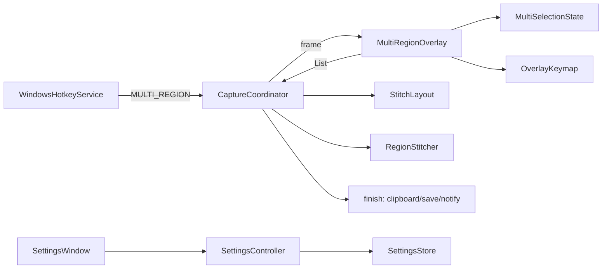
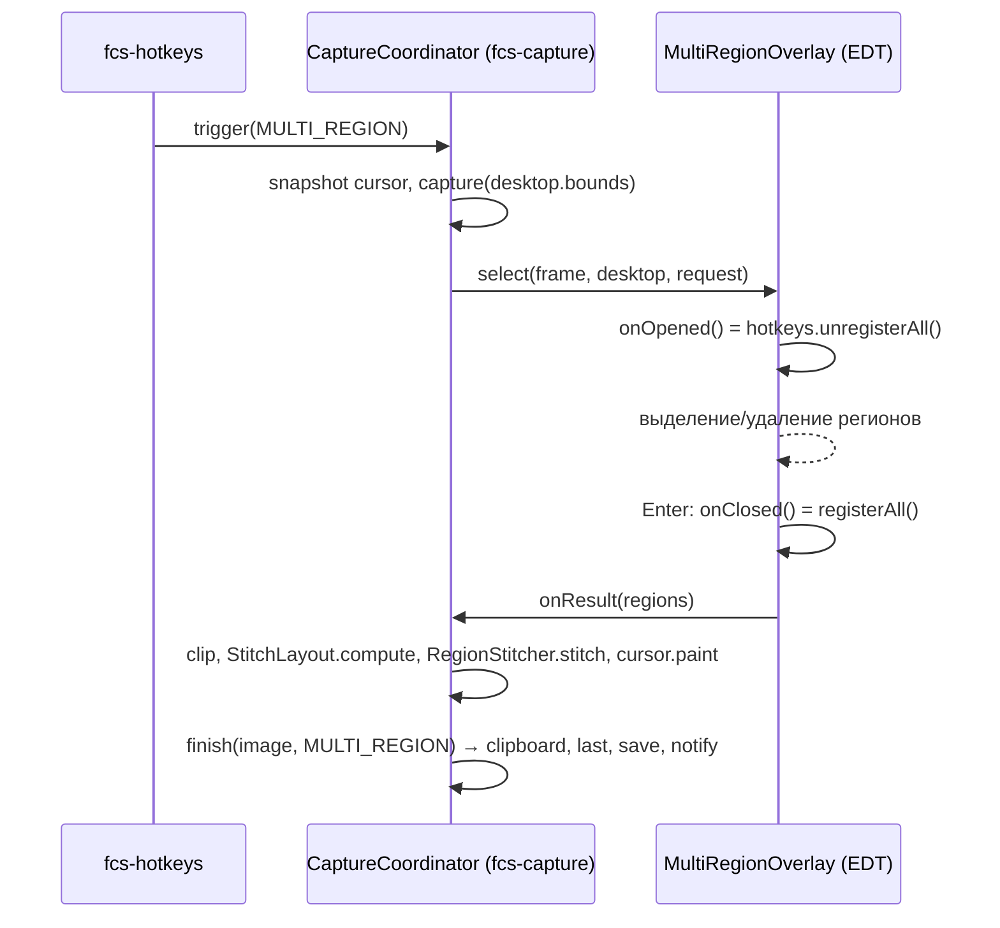

# TDD-003: Режим «Несколько областей» — выделение нескольких регионов и склейка

| Поле | Значение |
|---|---|
| Статус | Review |
| Автор | Tech |
| Дата | 2026-11-08 |
| Входные артефакты | REQ-002, US-008, US-009, US-010 (согласованы пользователем 2026-11-08), REQ-001, TDD-001 |
| ADR | ADR-001, ADR-002, ADR-003, ADR-005 |
| Задачи | TASK-023 – TASK-029 |

## 1. Цель и рамки

- **Цель:** добавить четвёртый режим захвата `MULTI_REGION`. По глобальной клавише (`Ctrl+Shift+4`) фиксируется кадр
  всего стола, показывается оверлей, на котором пользователь выделяет до N непересекающихся прямоугольников, удаляет их
  и подтверждает выбор локальными клавишами. Регионы склеиваются алгоритмом «сжатие пустот» в одно изображение, которое
  идёт в существующий конвейер REQ-001 (буфер, автосохранение, уведомление, «Сохранить как…»).
- **Входит:** REQ-002.1–2.31, REQ-002.N1–N6.
- **Не входит:** перемещение/изменение размера регионов, непрямоугольные регионы, раскладки, рамки на результате,
  прозрачность, сохранение регионов отдельными файлами (REQ-002 §2 «Не входит»); настройка клавиш оверлея режима
  «Область» REQ-001 (REQ-002 §8, решение пользователя).

## 2. Трассировка требований

| Требование / AC | Суть | Компонент(ы) | Задача(и) | Как проверяется |
|---|---|---|---|---|
| REQ-002.1, 2.2, US-010 AC-1 | Режим и глобальная клавиша `Ctrl+Shift+4` | `HotkeyAction.MULTI_REGION`, `HotkeySettings.multiRegion`, `CaptureMode.MULTI_REGION` | TASK-027 | unit + ручная |
| REQ-002.3 | Один замороженный кадр, оверлей на всех мониторах | `CaptureCoordinator`, `MultiRegionOverlay` | TASK-026, 027 | unit + ручная |
| REQ-002.4, 2.5 | Регион добавляется, оверлей не закрывается; рамки и номера | `MultiSelectionState`, `MultiRegionOverlay` | TASK-025, 026 | unit + ручная |
| REQ-002.6 | Размер и счётчик «k / N» | `MultiSelectionState.counterLabel/sizeLabel` | TASK-025, 026 | unit + ручная |
| REQ-002.7–2.9, US-008 AC-3, AC-4 | Запрет пересечений, касание допустимо, красная рамка | `MultiSelectionState` | TASK-025, 026 | unit + ручная |
| REQ-002.10 | < 2×2 игнорируется | `MultiSelectionState.release` | TASK-025 | unit |
| REQ-002.11, US-008 AC-5 | Лимит | `MultiSelectionState.press`, `MultiRegionSettings.effectiveMaxRegions` | TASK-024, 025 | unit |
| REQ-002.12 | Физические пиксели; вне мониторов `#808080` | кадр `FrameAssembler` (уже), обрезка по `desktop.bounds` в `CaptureCoordinator` | TASK-027 | unit |
| REQ-002.13–2.15, US-008 AC-6 | Удаление последнего / ПКМ по региону; ПКМ вне — ничего | `MultiSelectionState`, `MultiRegionOverlay` | TASK-025, 026 | unit + ручная |
| REQ-002.16–2.18, US-008 AC-7–9 | Собрать / пусто / отмена | `OverlayKeymap`, `MultiRegionOverlay`, `CaptureCoordinator` | TASK-024, 026, 027 | unit + ручная |
| REQ-002.19 | Подсказка клавиш | `MultiRegionOverlay.keysHint` | TASK-026 | unit + ручная |
| REQ-002.20–2.24, US-009 AC-1–5, REQ-002.N6 | Сжатие пустот | `StitchLayout`, `RegionStitcher` | TASK-023, 027 | unit |
| REQ-002.21, US-009 AC-7 | Цвет заливки | `MultiRegionSettings.fillRgb`, `RegionStitcher` | TASK-024, 027 | unit |
| REQ-002.25, US-009 AC-6 | Общий конвейер | `CaptureCoordinator.finish` (существующий) | TASK-027 | unit + ручная |
| REQ-002.26 (Could) | Указатель в перенесённой позиции | `CaptureCoordinator` | TASK-027 | unit |
| REQ-002.27, 2.30, US-010 AC-2, AC-5, AC-6 | Раздел настроек, валидация, сброс | `SettingsController`, `SettingsWindow` | TASK-028 | unit + ручная |
| REQ-002.28 | Локальные клавиши, основная + дополнительная | `OverlayKey`, `MultiRegionSettings`, ADR-005 | TASK-024 | unit |
| REQ-002.29, US-010 AC-3, AC-4 | Конфликты клавиш | `SettingsController.applyOverlayKey`, существующий `applyHotkey` | TASK-028 | unit |
| REQ-002.31 | Лимит применяется со следующего запуска | `MultiRegionRequest` создаётся в `trigger` | TASK-027 | unit |
| Допущение §6: приоритет оверлея | Глобальные клавиши сняты на время оверлея | `MultiRegionOverlay(onOpened, onClosed)`, `FastCowScreenshotApp` | TASK-026, 027 | ручная |
| REQ-002.N1–N3 | ≤ 250 мс, ≤ 50 мс, ≤ 500 мс | логи `Overlay shown`, `Multi-region confirm-to-clipboard` | TASK-026, 027, 029 | замер |
| REQ-002.N4, N5 | Пиксель в пиксель; heap | `RegionStitcher` (`System.arraycopy`) | TASK-027, 029 | unit + замер |

## 3. Принятые технические решения

| Вопрос | Решение | Альтернативы | Обоснование / ADR |
|---|---|---|---|
| Модель клавиш оверлея | `settings.OverlayKey` (AWT `VK_*`, модификаторы необязательны, `numpad`) | расширить `HotkeyBinding` | ADR-005 |
| Приоритет клавиш оверлея | `unregisterAll` при открытии, `registerAll` при закрытии | запрет совпадений | ADR-005 |
| Склейка | `domain.StitchLayout` (сжатие координат) + `capture.RegionStitcher` | вырезание полос в изображении | ADR-005 |
| Выбор цвета | 8 образцов + поле HEX в Compose | `JColorChooser`, библиотека | ADR-005 |
| Где оверлей | Новый класс `ui.MultiRegionOverlay` (Swing, как `RegionOverlay`); `RegionOverlay` не меняется | общий класс с флагом | Не рискуем регрессией REQ-001 |
| Хранение | Новое поле `AppSettings.multiRegion` + `HotkeySettings.multiRegion`; `CURRENT_VERSION` остаётся `1` | миграция v2 | Отсутствующие поля получают значения по умолчанию (`kotlinx.serialization`) |
| «Сохранение» настроек (US-010 AC-3–5) | Как в TDD-001: каждое изменение применяется сразу; конфликт/ошибка валидации — изменение отклоняется, текст ошибки под разделом | кнопка «Сохранить» | Единообразие с существующим окном |
| Таймер подсказок | `javax.swing.Timer` 2000 мс на EDT | поток | Без новых потоков (conventions §6) |

## 4. Архитектура

### 4.1. Компоненты



| Компонент | Пакет / файл | Ответственность | Поток |
|---|---|---|---|
| `StitchLayout`, `StitchPlacement` | `domain` / `StitchLayout.kt` | Размер результата и позиции регионов | любой |
| `OverlayKey` | `settings` / `OverlayKey.kt` | Клавиша оверлея: разбор, формат, сравнение | любой |
| `OverlayAction`, `KeySlot` | `settings` / `OverlayAction.kt`, `KeySlot.kt` | Действия оверлея и слоты сочетаний | любой |
| `OverlayKeymap` | `settings` / `OverlayKeymap.kt` | Нажатие → действие | любой |
| `MultiRegionSettings` | `settings` / `MultiRegionSettings.kt` | Настройки режима, значения по умолчанию, HEX | любой |
| `MultiRegionSelector`, `MultiRegionRequest` | `capture` | Интерфейс оверлея | EDT |
| `MultiSelectionState` (+ `PressResult`, `ReleaseResult`) | `ui` / `MultiSelectionState.kt` | Состояние выделения без AWT | EDT |
| `MultiRegionOverlay` | `ui` / `MultiRegionOverlay.kt` | Окна, отрисовка, мышь, клавиши, подсказки | EDT |
| `RegionStitcher` | `capture` / `RegionStitcher.kt` | Копирование пикселей по `StitchLayout` | `fcs-capture` |
| `CaptureCoordinator` (изменение) | `capture` | Сценарий `MULTI_REGION` | `fcs-capture` / EDT |
| `OverlayKeyRecorder`, `OverlayRecordingStep` | `ui` | Запись клавиши оверлея в настройках | EDT |
| `SettingsController`, `SettingsWindow` (изменение) | `ui` | Раздел «Несколько областей» | EDT |

### 4.2. Правила зависимостей

`domain.StitchLayout` — только `PixelRect`. `settings.OverlayKey` не импортирует `java.awt` (константы `VK_*` объявлены
у себя, значения равны AWT). `capture` не знает об `ui`; оверлей подключается через `MultiRegionSelector`.
Снятие/возврат глобальных клавиш передаётся в `MultiRegionOverlay` лямбдами из `app`.

## 5. Контракты

```kotlin
// domain/StitchLayout.kt
internal data class StitchPlacement(val source: PixelRect, val targetLeft: Int, val targetTop: Int)
internal data class StitchLayout(val width: Int, val height: Int, val placements: List<StitchPlacement>) {
    companion object { fun compute(regions: List<PixelRect>): StitchLayout }
}

// settings
internal enum class OverlayAction(val displayName: String) { CONFIRM, REMOVE_LAST, CANCEL }
internal enum class KeySlot { PRIMARY, SECONDARY }
internal data class OverlayKey(val ctrl: Boolean, val alt: Boolean, val shift: Boolean, val keyCode: Int, val numpad: Boolean = false)
internal data class OverlayKeymap(val confirm: List<OverlayKey>, val removeLast: List<OverlayKey>, val cancel: List<OverlayKey>)
@Serializable internal data class MultiRegionSettings(/* maxRegions, fillColor, 6 строк клавиш */)

// capture
internal data class MultiRegionRequest(val maxRegions: Int, val keymap: OverlayKeymap)
internal interface MultiRegionSelector {
    fun select(frame: BufferedImage, desktop: VirtualDesktop, request: MultiRegionRequest, onResult: (List<PixelRect>?) -> Unit)
}
internal object RegionStitcher {
    fun stitch(frame: BufferedImage, frameOrigin: PixelPoint, layout: StitchLayout, fillRgb: Int): BufferedImage
}
```

Полные сигнатуры с KDoc — в задачах TASK-023 – TASK-028.

## 6. Сценарии и потоки данных

### 6.1. Основной сценарий



1. `trigger` (поток `fcs-hotkeys`): `busy` CAS, снимок `settings()`; `MultiRegionRequest` строится из этого снимка
   (REQ-002.31).
2. `fcs-capture`: указатель (если включён), кадр `desktop.bounds`, передача на EDT.
3. EDT: оверлей. Отмена → `onResult(null)`. Подтверждение → `onResult(regions)` в порядке добавления.
4. `fcs-capture`: обрезка по `desktop.bounds`, отбрасывание пустых / < 2×2, склейка, указатель, `finish`.

## 7. Многопоточность и состояние

- `MultiSelectionState` и все поля `MultiRegionOverlay` — только EDT.
- `frame` после передачи в оверлей только читается (EDT при отрисовке, затем `fcs-capture` при склейке — после
  закрытия окон, happens-before через `Executor.execute`).
- `busy` освобождается при отмене, ошибке и в `finish` (как для `REGION`).

### 7.1. Состояния оверлея

| Состояние | Событие | Новое состояние | Действие |
|---|---|---|---|
| `Idle` | ЛКМ нажата, `count < max`, точка вне регионов | `Dragging` | якорь |
| `Idle` | ЛКМ нажата, `count == max` | `Idle` | подсказка лимита |
| `Idle` | ЛКМ нажата внутри региона | `Idle` | подсказка пересечения |
| `Dragging` | ЛКМ отпущена: < 2×2 | `Idle` | ничего |
| `Dragging` | ЛКМ отпущена: пересечение | `Idle` | подсказка пересечения |
| `Dragging` | ЛКМ отпущена: ок | `Idle` | регион добавлен |
| `Idle` | ПКМ внутри региона | `Idle` | регион удалён |
| любое | «Удалить последнюю» | без изменения | последний регион удалён |
| любое | «Собрать», регионов 0 | без изменения | подсказка «Выделите хотя бы одну область» |
| любое | «Собрать», регионов ≥ 1 | закрыт | `onResult(regions)` |
| любое | «Отмена» | закрыт | `onResult(null)` |

## 8. Алгоритмы и формулы

**Сжатие координат по одной оси** (для X — отрезки `[left, right)`, для Y — `[top, bottom)`):

1. Отсортировать отрезки по началу; слить: если `start <= curEnd` — `curEnd = max(curEnd, end)`, иначе новый отрезок.
2. Для слитых отрезков посчитать `offset` — сумму длин предыдущих отрезков.
3. `map(c)` = `offset(seg) + (c − seg.start)`, где `seg` — слитый отрезок, содержащий `c` (`seg.start ≤ c < seg.end`).
4. Длина оси результата — сумма длин слитых отрезков.

`placements` сортируются по `(source.top, source.left)` — результат не зависит от порядка входа (REQ-002.23).

**Пример (REQ-002 §3.4):** A = (0,0,100,50), B = (500,300,200,100). X: `[0,100)`, `[500,700)` → offset 0 и 100,
ширина 300; Y: `[0,50)`, `[300,400)` → offset 0 и 50, высота 150. A → (0,0), B → (100,50).

**Пример с отрицательными координатами:** A = (−1920,100,100,50), B = (0,0,200,100). X: `[−1920,−1820)`, `[0,200)` →
ширина 300, A.x → 0, B.x → 100. Y: `[0,100)` и `[100,150)` сливаются (касание) в `[0,150)` → высота 150, A.y → 100,
B.y → 0.

**Копирование:** результат `TYPE_INT_RGB` заливается `fillRgb`; для каждой строки `row` региона:
`srcIndex = (src.top − origin.y + row) · frame.width + (src.left − origin.x)`,
`dstIndex = (targetTop + row) · width + targetLeft`, `System.arraycopy(src, srcIndex, dst, dstIndex, src.width)`.

## 9. Обработка ошибок

| Ситуация | Где | Поведение | Лог | Пользователь |
|---|---|---|---|---|
| Окно оверлея не размещено | `MultiRegionOverlay` | Закрыть, `onResult(null)` | `WARN "Multi-region overlay closed: {}"` | ничего |
| Склейка бросила исключение | `CaptureCoordinator` | `fail(e)` | `ERROR "Capture failed"` | `"Не удалось сделать снимок"` |
| Все регионы пустые после обрезки | `CaptureCoordinator` | как отмена | `INFO "Multi-region capture cancelled"` | ничего |
| Повторная регистрация клавиш после оверлея не удалась | `FastCowScreenshotApp` | продолжить | `WARN "Hotkeys not restored after overlay: {}"` | ничего |
| Некорректные значения в `settings.json` | `MultiRegionSettings` | лимит `coerceIn(2, 50)`, цвет → `#808080`, клавиша → по умолчанию | — | ничего |
| Конфликт / неверный ввод в настройках | `SettingsController` | изменение отклонено | — | текст ошибки (TASK-028) |

## 10. Конфигурация, константы и тексты UI

| Имя | Значение | Где | Требование |
|---|---|---|---|
| Глобальная клавиша | `"Ctrl+Shift+4"` | `HotkeySettings.multiRegion` | REQ-002.2 |
| `DEFAULT_MAX_REGIONS` / диапазон | `10` / `2..50` | `MultiRegionSettings` | REQ-002.11, 2.27 |
| `DEFAULT_FILL_COLOR` | `"#808080"` | `MultiRegionSettings` | REQ-002.21 |
| Клавиши по умолчанию | `Enter`/`NumPad Enter`, `Backspace`/`Ctrl+Z`, `Esc`/— | `MultiRegionSettings` | REQ-002.13, 16, 18 |
| `MESSAGE_DURATION_MS` | `2000` | `MultiRegionOverlay` | REQ-002.8 |
| `INVALID_RGB` | `0xE74C3C` | `MultiRegionOverlay` | REQ-002.8 |

| Место | Текст |
|---|---|
| Пересечение | `"Области не должны пересекаться"` |
| Лимит | `"Достигнут лимит: %d областей. %s — собрать снимок"` |
| Пусто | `"Выделите хотя бы одну область"` |
| Подсказка клавиш | `"%s — собрать · %s — удалить последнюю · %s — отмена"` |
| Счётчик | `"%d / %d"` |
| Режим | `"Несколько областей"` |

Тексты окна настроек — в TASK-028.

## 11. Хранение данных и форматы

`settings.json` (версия 1, без миграции): в `hotkeys` добавляется `"multiRegion": "Ctrl+Shift+4"`, в корень —
объект `"multiRegion"`:

```json
"multiRegion": {
  "maxRegions": 10, "fillColor": "#808080",
  "confirmKey": "Enter", "confirmKeyAlt": "NumPad Enter",
  "removeLastKey": "Backspace", "removeLastKeyAlt": "Ctrl+Z",
  "cancelKey": "Esc", "cancelKeyAlt": ""
}
```

Старые файлы без этих полей читаются со значениями по умолчанию.

## 12. Логирование

`INFO "Multi-region overlay shown in {} ms"`, `INFO "Multi-region stitched {} regions into {}x{}"`,
`INFO "Multi-region confirm-to-clipboard {} ms"`, `INFO "Multi-region capture cancelled"`,
`DEBUG "Region rejected: {}"` (причина). Координаты регионов — только `DEBUG`. Содержимое кадра не логировать.

## 13. Производительность и ресурсы

| NFR | Как достигается | Как измеряется |
|---|---|---|
| N1 ≤ 250 мс | Как `RegionOverlay` (кадр уже снят) | лог `Multi-region overlay shown in` |
| N2 ≤ 50 мс, ≥ 30 к/с | Отрисовка `drawImage` фрагментов, без копий кадра | ручная (TASK-029) |
| N3 ≤ 500 мс | `arraycopy` построчно; результат ≤ bbox | лог `Multi-region confirm-to-clipboard` |
| N5 heap | Одна копия результата ≤ bbox, кадр уже в памяти | замер heap (TASK-029) |

## 14. Стратегия тестирования

| Уровень | Что | Задачи |
|---|---|---|
| Unit | `StitchLayout` (все случаи N6), `OverlayKey`, `OverlayKeymap`, `MultiRegionSettings`, `MultiSelectionState`, `RegionStitcher`, `CaptureCoordinator` (`MULTI_REGION`), `SettingsController`, `OverlayKeyRecorder` | 023–028 |
| Ручной | Оверлей на мультимониторе, клавиши, настройки, замеры NFR | 026, 028, 029 |

## 15. Риски

| Риск | Вероятность | Влияние | Митигация |
|---|---|---|---|
| Глобальные клавиши не восстановятся после оверлея | Низкая | Режимы не запускаются | `WARN` в лог, повторная регистрация при изменении настроек |
| Отрисовка 3×4K при перетаскивании < 30 к/с | Средняя | N2 | рисовать только видимые фрагменты; замер в TASK-029 |

## 16. План задач

| Порядок | Задача | Название | Зависит от | Оценка |
|---|---|---|---|---|
| 1 | TASK-023 | Раскладка склейки `StitchLayout` | — | M |
| 2 | TASK-024 | Настройки режима и клавиши оверлея | — | M |
| 3 | TASK-025 | Состояние выделения и интерфейс `MultiRegionSelector` | 024 | M |
| 4 | TASK-026 | Оверлей `MultiRegionOverlay` | 025 | L |
| 5 | TASK-027 | Режим `MULTI_REGION` в координаторе, склейка, подключение | 023, 024, 026 | L |
| 6 | TASK-028 | Раздел настроек «Несколько областей» | 027 | L |
| 7 | TASK-029 | Приёмка и замеры NFR | 028 | S |

## 17. Допущения и открытые вопросы

- **Допущение:** «при сохранении» в US-010 AC-3–5 = в момент применения изменения (окно настроек применяет каждое
  изменение сразу, TDD-001).
- **Допущение:** указатель (REQ-002.26) рисуется без обрезки по границе региона и может заходить на соседний регион
  или заливку.
- **Допущение:** начало перетаскивания внутри региона (REQ-002.9) сразу показывает подсказку «Области не должны
  пересекаться».
- **Допущение:** счётчик, подсказка клавиш и временные сообщения показываются на каждом мониторе.
- **Допущение:** запись клавиши оверлея в настройках отменяется кнопкой «Отменить» (`Esc` — допустимая клавиша
  оверлея и записывается как значение).
- Статусы REQ-002 и US-008–010 в документах Analyst остаются `Draft` (правка `docs/analysis/requirements` и
  `user-stories` агенту Tech запрещена); пользователь согласовал их 2026-11-08 — нужно обновить через `/analyze`.
