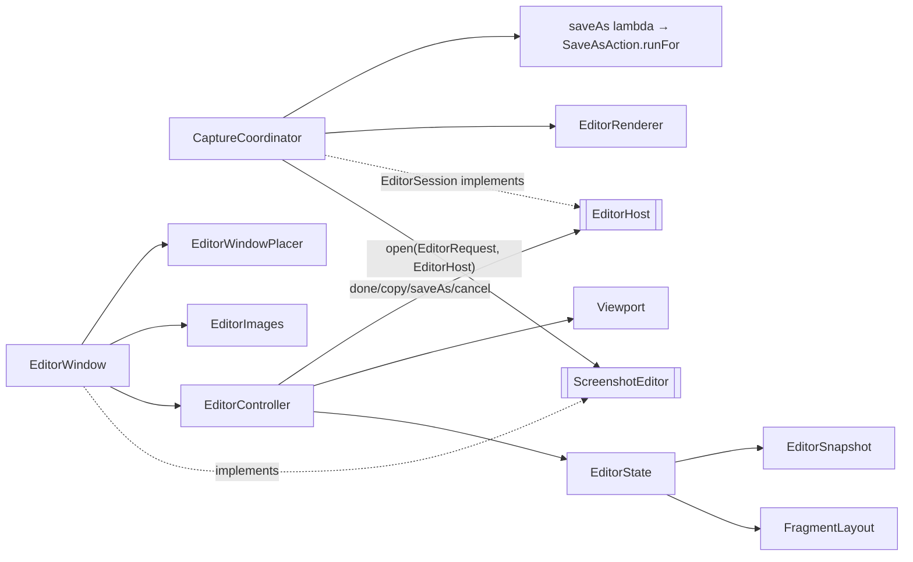
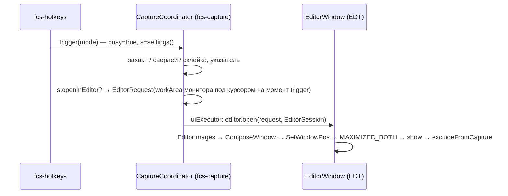

# TDD-004: Редактор снимков — карандаш, перемещение и склейка фрагментов, масштаб

| Поле | Значение |
|---|---|
| Статус | Approved |
| Автор | Tech |
| Дата | 2026-11-15 |
| Входные артефакты | REQ-003, US-011 – US-014, REQ-001, REQ-002, TDD-001, TDD-003 |
| ADR | ADR-006 (новый), ADR-001, ADR-002, ADR-005 |
| Задачи | TASK-031 – TASK-040 |

## 1. Цель и рамки

- **Цель:** добавить окно редактора, которое открывается после успешного захвата, если включена настройка
  `openInEditor`. В редакторе можно рисовать карандашом, перемещать и склеивать фрагменты режима «Несколько областей»,
  отменять и повторять действия, менять масштаб и прокручивать снимок. Результат уходит в существующий конвейер
  `CaptureCoordinator.finish` («Готово») или только в буфер («Копировать») / в файл («Сохранить как…»).
- **Входит:** всё из REQ-003 §2 «Входит», включая Could REQ-003.29 (стрелки) и REQ-003.31 (указатель движется с
  фрагментом), а также клавиши `V`/`P` (допущение US-013).
- **Не входит:** REQ-003 §2 «Не входит»; настройка клавиш редактора; прокрутка перетаскиванием полос прокрутки (полосы
  только показывают положение, прокрутка — колесом); перенос штрихов вместе с фрагментами.

## 2. Трассировка требований

| Требование / AC | Суть | Компонент(ы) | Задача(и) | Как проверяется |
|---|---|---|---|---|
| REQ-003.1, US-011 AC-1 | Флажок, по умолчанию выкл., сохраняется | `AppSettings.openInEditor`, `SettingsController`, `SettingsWindow` | 031 | unit + ручная |
| REQ-003.2 | Выключен — как раньше | `CaptureCoordinator` | 036 | unit (старые тесты + новый) |
| REQ-003.3, US-011 AC-2 | Включён — до действия ничего не меняется | `CaptureCoordinator` | 036 | unit |
| REQ-003.4 | Флажок — со следующего захвата | `CaptureCoordinator` (снимок настроек в `trigger`) | 036 | unit |
| REQ-003.5, US-011 AC-10 | Отменённый захват не открывает редактор | `CaptureCoordinator` | 036 | unit |
| REQ-003.6 | Указатель рисуется до редактора | `CaptureCoordinator` (без изменений порядка) | 036 | unit |
| REQ-003.7 | Обычное окно, развёрнуто на мониторе под курсором, фокус | `EditorWindow`, `EditorWindowPlacer` | 036 (`workArea`), 038 | ручная |
| REQ-003.8 | Состав окна | `EditorContent` | 038 | ручная |
| REQ-003.9, US-014 AC-1, AC-2 | Вписать, не больше 100 % | `Viewport.fit` | 035, 037 | unit |
| REQ-003.10, US-014 AC-3, AC-4 | Ctrl+колесо, Ctrl+0/1, 10–800 %, прокрутка | `Viewport`, `EditorController.onWheel`, `EditorKeymap` | 035, 037, 038 | unit + ручная |
| REQ-003.11, US-014 AC-5 | Итог без масштабирования | `EditorRenderer` | 033 | unit |
| REQ-003.12 | Окно не попадает в снимки | `WindowHandles.excludeFromCapture` | 038 | ручная |
| REQ-003.13, US-011 AC-9 | Клавиши захвата игнорируются, окно вперёд, подсказка | `CaptureCoordinator.trigger`, `EditorWindow.bringToFront` | 036, 038 | unit + ручная |
| REQ-003.14 | Один редактор | `busy` координатора | 036 | unit |
| REQ-003.15, 3.21, US-012 AC-1 | Штрих, скругление, сглаживание, виден во время рисования | `EditorController`, `EditorRenderer`, холст | 033, 037, 039 | unit + ручная |
| REQ-003.16, US-012 AC-5 | Точка | `EditorRenderer` (эллипс), холст (`drawCircle`) | 033, 038 | unit |
| REQ-003.17, US-012 AC-2 | Толщина в px изображения | `Stroke.width`, `EditorRenderer` | 032, 033 | unit |
| REQ-003.18, US-012 AC-3 | Палитра 6 цветов, непрозрачно | `EditorSettings.PALETTE` | 031, 037 | unit |
| REQ-003.19, US-012 AC-4 | Запоминать цвет/толщину | `EditorSettings`, `EditorController.onPenChanged` | 031, 037, 038 | unit + ручная |
| REQ-003.20, US-012 AC-6 | Отсечение по границе | `EditorRenderer`, `clipRect` холста | 033, 038 | unit |
| REQ-003.22 | Не-MULTI — только карандаш | `EditorState.tool`, `EditorContent` | 034, 038 | unit |
| REQ-003.23, US-013 AC-1 | Исходная раскладка = REQ-002.20, инструмент «Перемещение» | `EditorRequest.fragments`, `EditorState` | 034, 036 | unit |
| REQ-003.24 | Перетаскивание на целые px, курсор и рамка | `EditorController`, холст | 037, 039 | unit + ручная |
| REQ-003.25, US-013 AC-4, AC-5 | Запрет пересечения, касание допустимо | `FragmentLayout.intersectsAny`, `EditorState.moveFragment` | 032, 034, 037 | unit |
| REQ-003.26, US-013 AC-2, AC-3 | Нормализация в (0,0), Ш×В сразу | `FragmentLayout.normalizeShift`, `EditorController.statusText` | 032, 034, 037 | unit |
| REQ-003.27, US-013 AC-7 | Ограничение Σw × Σh | `FragmentLayout.clampPosition` | 032, 037 | unit |
| REQ-003.28, US-013 AC-6 | «Склеить» по текущим позициям | `FragmentLayout.stitchPositions` | 032, 034 | unit |
| REQ-003.29 | Стрелки 1 / 10 px | `EditorKeymap`, `EditorController.nudge` | 035, 037 | unit |
| REQ-003.30, US-013 AC-8, AC-9 | Блокировка после штрихов | `EditorState.canMove`, `EditorController` | 034, 037, 038 | unit |
| REQ-003.31 | Указатель движется с фрагментом | пиксели указателя внутри исходного прямоугольника фрагмента | 033 | unit (копия пикселей) |
| REQ-003.32 | Одна область — без изменений | `EditorState.moveFragment` → `Unchanged` | 034 | unit |
| REQ-003.33 – 3.35, US-012 AC-7, AC-8, US-013 AC-10 | История, глубина ≥ 100 | `EditorState` (без ограничения глубины) | 034 | unit |
| REQ-003.36 | Отмена всего = исходник | `EditorState` + `EditorRenderer` | 034 | unit |
| REQ-003.37, US-011 AC-3 | «Готово» → конвейер | `EditorController.done`, `CaptureCoordinator.EditorSession.done` | 036, 037 | unit |
| REQ-003.38, US-011 AC-5 | «Копировать» | `EditorSession.copy` | 036, 037 | unit |
| REQ-003.39, US-011 AC-6 | «Сохранить как…» | `EditorSession.saveAs`, `SaveAsAction.runFor` | 036, 037 | unit |
| REQ-003.40, US-011 AC-7, AC-8 | «Отмена», подтверждение | `EditorController.requestCancel`, `EditorState.isDirty` | 034, 037, 038 | unit + ручная |
| REQ-003.41 | Отмена ничего не меняет | `EditorSession.cancel` | 036 | unit |
| REQ-003.42 | Имя файла — по времени захвата | `finish(…, capturedAt, …)` | 036 | unit |
| REQ-003.43, US-011 AC-4 | Без изменений = снимок без редактора | `EditorRenderer` (копия исходника) | 033, 036 | unit |
| REQ-003.44 | Ошибки буфера/диска | существующий `finish` | 036 | unit (существующие) |
| REQ-003.45 | Выход из трея с подтверждением | `EditorWindow.confirmCloseForExit`, `FastCowScreenshotApp.exit` | 037, 038 | unit + ручная |
| REQ-003.N1 | Появление ≤ 500 / 800 мс | `EditorImages`, лог `Editor shown in N ms` | 038, 040 | замер |
| REQ-003.N2, N3 | ≥ 30 кадров/с, Undo ≤ 200 мс | Skia-холст, модель без растров | 038, 039, 040 | замер |
| REQ-003.N4 | «Готово» → буфер ≤ 500 мс | `EditorRenderer` на `fcs-capture`, лог `Captured … in N ms` | 036, 040 | замер |
| REQ-003.N5 | Точность пикселей | `EditorRenderer` | 033 | unit + ручная |
| REQ-003.N6 | Heap ≤ 400 МБ, RSS без роста | `EditorImages` (без промежуточного `IntArray`), `dispose` окна | 038, 040 | замер |
| REQ-003.N7 | Модульные тесты | `editor.*`, `EditorController` | 032 – 037 | unit |

## 3. Принятые технические решения

| Вопрос | Решение | Альтернативы | Обоснование / ADR |
|---|---|---|---|
| UI окна и холста | `ComposeWindow` + Compose `Canvas` (Skia) | Swing + Java2D | ADR-006, ответ пользователя 2026-11-15 |
| Модель | Пакет `editor`: позиции фрагментов + список штрихов; история команд `AddStroke` / `ChangeLayout(before, after)`; глубина не ограничена | Растровые снимки | ADR-006 |
| Итоговое изображение | `EditorRenderer.render(EditorSnapshot)` (Java2D) на `fcs-capture` | Снимок холста | ADR-006 |
| Если раскладка не менялась | Итог = копия исходного снимка целиком | Всегда заливка + фрагменты | REQ-003.43: сохраняет части указателя вне фрагментов |
| Интеграция | `ScreenshotEditor` / `EditorHost` / `EditorRequest` в `capture`; `busy` удерживается, пока открыт редактор | Свой конвейер в UI | ADR-006 |
| «Сохранить как…» из редактора | `SaveAsAction.runFor(shot, onSaved)`; последний снимок обновляется после успешной записи | Новый класс | Переиспользование REQ-001.38–41, 55 |
| Настройки «Готово» | Автосохранение и директория берутся из `settings()` в момент «Готово» | Снимок настроек при захвате | Пользователь мог поменять папку, пока редактор открыт |
| Последний снимок при «Копировать» | Обновляется всегда (и при ошибке буфера) | Только при успехе | REQ-003.38: «обновляет последний снимок» |
| Размещение окна | `SetWindowPos` в рабочую область монитора (физ. px) до показа, затем `MAXIMIZED_BOTH` | Подбор `GraphicsDevice` | ADR-006 |
| Подтверждение закрытия | `JOptionPane.showOptionDialog`, кнопки `"Закрыть"`, `"Вернуться"`, по умолчанию «Вернуться» | Compose-диалог | Модальность и `Esc` без своего кода |
| Уведомление «Скопировано…» | Существующий `CaptureNotifier.showMessage` | Подсказка в окне | REQ-003.38: «уведомление» |
| Подсказки в окне | Полоса поверх холста на 2000 мс | — | Как оверлей REQ-002 |
| Преобразование снимка для Skia | Свой конвертер `TYPE_INT_RGB` → `ByteArray` BGRA → `Bitmap.installPixels` | `toComposeImageBitmap()` (+100 МБ `IntArray` в heap) | REQ-003.N6 |
| Окно на каждое открытие | Новое `ComposeWindow`, `dispose()` при закрытии | Переиспользование скрытого окна | REQ-003.N6: память освобождается |
| Колесо | Compose: 1 щелчок = `scrollDelta` 1.0; `Shift` даёт `scrollDelta.x`. Прокрутка 100 px на 1.0; масштаб — шаг ×1.25 на событие | — | Исходники Compose Desktop (`ComposeSceneMediator`) |

## 4. Архитектура

### 4.1. Компоненты



| Компонент | Пакет / файл | Ответственность | Зависит от | Поток |
|---|---|---|---|---|
| `EditorSettings` | `settings/EditorSettings.kt` | Цвет и толщина карандаша, палитра | — | любой |
| `StrokePoint`, `Stroke` | `editor/Stroke.kt` | Штрих в координатах изображения | — | любой (неизменяемы) |
| `EditorTool` | `editor/EditorTool.kt` | `MOVE`, `PENCIL` | — | — |
| `FragmentLayout` | `editor/FragmentLayout.kt` | Геометрия фрагментов: границы, нормализация, пересечения, ограничение, склейка, попадание | `domain` | любой |
| `EditorSnapshot` | `editor/EditorSnapshot.kt` | Неизменяемое состояние для рендера | `domain` | любой |
| `EditorRenderer` | `editor/EditorRenderer.kt` | Итоговое изображение Java2D | `EditorSnapshot` | `fcs-capture` |
| `EditCommand`, `MoveOutcome` | `editor/EditCommand.kt`, `editor/MoveOutcome.kt` | Команды истории, результат перемещения | `domain` | — |
| `EditorState` | `editor/EditorState.kt` | Позиции, штрихи, инструмент, история, «грязность» | `FragmentLayout`, `EditorSnapshot` | EDT (не потокобезопасен) |
| `Viewport` | `editor/Viewport.kt` | Масштаб и сдвиг отображения | — | любой (неизменяем) |
| `EditorRequest`, `EditorHost`, `ScreenshotEditor` | `capture/*.kt` | Контракт координатор ↔ редактор | `domain`, `editor` | см. §5 |
| `CaptureCoordinator` (изм.) | `capture/CaptureCoordinator.kt` | Открытие редактора, сессия, рендер, конвейер | все выше | `fcs-capture`, EDT |
| `SaveAsAction.runFor` (нов.) | `ui/SaveAsAction.kt` | «Сохранить как…» заданного снимка | — | `fcs-dialog` |
| `EditorKeyAction`, `EditorKeymap` | `ui/EditorKeyAction.kt`, `ui/EditorKeymap.kt` | Клавиши редактора (чистая функция) | — | любой |
| `EditorController` | `ui/EditorController.kt` | Логика окна: инструменты, жесты, масштаб, завершение | `EditorState`, `Viewport`, `EditorHost` | EDT |
| `EditorImages` | `ui/EditorImages.kt` | `BufferedImage` → `ImageBitmap` | Skia | EDT |
| `EditorWindowPlacer` | `platform/windows/EditorWindowPlacer.kt` | `SetWindowPos` в рабочую область | JNA | EDT |
| `EditorWindow`, `EditorContent` | `ui/EditorWindow.kt`, `ui/EditorContent.kt` | Окно Compose, панель, холст, ввод | `EditorController` | EDT |

### 4.2. Правила зависимостей

- `editor` не знает о `capture`, `ui`, `settings`, Compose и JNA. Его используют `capture` (рендер) и `ui`.
- `capture` не знает об окне: только интерфейс `ScreenshotEditor`. `EditorWindow` (ui) реализует его.
- `EditorController` не импортирует Compose и Swing: всё окно-зависимое передаётся лямбдами (`showHint`,
  `confirmDiscard`, `closeWindow`, `onCanvasChanged`, `onChromeChanged`).
- Skia (`org.jetbrains.skia`) — только в `ui/EditorImages.kt`.

## 5. Контракты

```kotlin
// settings/EditorSettings.kt
@Serializable
internal data class EditorSettings(val penColor: String = "#FF0000", val penWidth: Int = 4) {
    fun penRgb(): Int              // цвет из палитры, иначе 0xFF0000
    fun effectivePenWidth(): Int   // 2/4/8/16, иначе 4
}
// AppSettings: + val openInEditor: Boolean = false, + val editor: EditorSettings = EditorSettings()

// editor/Stroke.kt
internal data class StrokePoint(val x: Float, val y: Float)
internal data class Stroke(val rgb: Int, val width: Int, val points: List<StrokePoint>)

// editor/EditorSnapshot.kt
internal data class EditorSnapshot(
    val base: BufferedImage, val sources: List<PixelRect>, val positions: List<PixelPoint>,
    val initialPositions: List<PixelPoint>, val fillRgb: Int, val strokes: List<Stroke>,
) { val width: Int; val height: Int; companion object { fun initial(base, sources, fillRgb): EditorSnapshot } }

// editor/EditorRenderer.kt
internal object EditorRenderer { fun render(snapshot: EditorSnapshot): BufferedImage }

// capture/EditorRequest.kt, EditorHost.kt, ScreenshotEditor.kt
internal data class EditorRequest(
    val image: BufferedImage, val mode: CaptureMode, val capturedAt: LocalDateTime,
    val fragments: List<PixelRect>, val fillRgb: Int, val workArea: PixelRect, val startNs: Long,
)
internal interface EditorHost {
    fun done(result: EditorSnapshot)
    fun copy(result: EditorSnapshot, onResult: (Boolean) -> Unit)
    fun saveAs(result: EditorSnapshot, onSaved: () -> Unit)
    fun cancel()
}
internal interface ScreenshotEditor {
    fun open(request: EditorRequest, host: EditorHost)
    fun bringToFront()
}
```

Полные контракты с KDoc — в задачах: `EditorSettings` — TASK-031; `Stroke`, `EditorTool`, `FragmentLayout` —
TASK-032; `EditorSnapshot`, `EditorRenderer` — TASK-033; `EditorState`, `EditCommand`, `MoveOutcome` — TASK-034;
`Viewport`, `EditorKeymap` — TASK-035; `capture`-контракты и изменения координатора — TASK-036;
`EditorController` — TASK-037; `EditorWindow`, `EditorImages`, `EditorWindowPlacer` — TASK-038.

## 6. Сценарии и потоки данных

### 6.1. Открытие



1. `trigger` (без изменений) берёт снимок настроек `s`. Если `s.openInEditor`, `runCapture` сразу после
   `monitors.desktop()` запоминает `editorArea = monitors.monitorUnderCursor(desktop).workArea`.
2. Каждое место, где раньше вызывался `finish(image, …)`, вызывает `complete(image, mode, capturedAt, s, start, req)`:
   если `req == null`, вызывается `finish`, иначе — `openEditor(req)`.
3. `openEditor`: `editorOpen = true`; `uiExecutor.execute { editor.open(req, EditorSession(req)) }`. `busy` остаётся
   `true`.

### 6.2. Завершение

| Действие | Поток | Что делает `EditorSession` |
|---|---|---|
| `done(snapshot)` | EDT → `fcs-capture` | `render` → `editorOpen=false` → `finish(image, mode, capturedAt, settings(), doneNs)` (буфер, последний снимок, `busy=false`, автосохранение, уведомление) |
| `copy(snapshot, cb)` | EDT → `fcs-capture` → EDT | `render` → `clipboard.write` → `lastScreenshot.set` → уведомление → `cb(ok)` |
| `saveAs(snapshot, cb)` | EDT → `fcs-capture` → `fcs-dialog` → EDT | `render` → `saveAs(Screenshot, cb)` (`SaveAsAction.runFor`) |
| `cancel()` | любой | `editorOpen=false`, `busy=false` |

`done` и `cancel` срабатывают один раз (флаг `closed`); после них `copy`/`saveAs` игнорируются.

### 6.3. Клавиша захвата при открытом редакторе

`trigger`: CAS `busy` не прошёл → если `editorOpen`, то `uiExecutor.execute { editor.bringToFront() }` →
`EditorWindow`: `toFront()`, `requestFocus()`, подсказка `"Завершите редактирование снимка"`.

### 6.4. Выход из трея

`FastCowScreenshotApp.exit()` сначала вызывает `editorWindow.confirmCloseForExit()`. Если редактора нет или изменений
нет — редактор закрывается (`host.cancel()`) и выход продолжается. Если изменения есть — вопрос; «Вернуться» отменяет
выход.

## 7. Многопоточность и состояние

- `EditorState`, `EditorController`, `EditorWindow` — только EDT.
- `EditorSnapshot` неизменяем (исходный `BufferedImage` никто не изменяет), поэтому безопасно передаётся на
  `fcs-capture`.
- Координатор: `busy` и новый `editorOpen` — `AtomicBoolean`. `editorOpen` сбрасывается **до** `busy`.
- `EditorSession.closed` — `AtomicBoolean`: первый `done`/`cancel` выигрывает.
- Жизненный цикл окна: создаётся в `open`, `dispose()` при закрытии (отложенно через `invokeLater`, ловушка §15).
  `EditorWindow.session = null` — ссылки на снимок освобождаются.

### 7.1. Состояния координатора

| Состояние | Событие | Новое состояние | Действие |
|---|---|---|---|
| `Idle` (busy=false) | `trigger` | `Capturing` | захват |
| `Capturing` | захват готов, `openInEditor=false` | `Idle` | `finish` |
| `Capturing` | захват готов, `openInEditor=true` | `Editing` (busy=true, editorOpen=true) | `editor.open` |
| `Capturing` | отмена оверлея | `Idle` | — |
| `Editing` | `trigger` | `Editing` | `bringToFront` |
| `Editing` | `copy` / `saveAs` | `Editing` | рендер + буфер / диалог |
| `Editing` | `done` | `Idle` | рендер + `finish` |
| `Editing` | `cancel` | `Idle` | — |
| `Editing` | `editor.open` бросил исключение | `Idle` | ERROR-лог, исходный снимок через `finish` |

## 8. Алгоритмы и формулы

**Координаты.** Изображение: пиксель `(i, j)` занимает `[i, i+1) × [j, j+1)`. Холст (Compose, px):
`canvas = offset + image · zoom`; `image = (canvas − offset) / zoom`.

**Вписывание (REQ-003.9):** `zoom = min(1.0, cw / iw, ch / ih).coerceIn(0.1, 8.0)`; по каждой оси, если
`iw·zoom ≤ cw` — `offX = (cw − iw·zoom) / 2`, иначе `offX ∈ [cw − iw·zoom, 0]`.
Пример: 11520×2160 в холсте 3840×2000 → `zoom = 0.3333`, контент 3840×720, `offX = 0`, `offY = 640`. Снимок 300×200 →
`zoom = 1.0`, `offX = 1770`, `offY = 900`.

**Масштаб относительно точки:** `ix = (ax − offX) / zoom`; `offX' = ax − ix · zoom'`; затем ограничение по осям.
Пример: `zoom = 0.5`, `offX = 100`, `ax = 300` → `ix = 400`; `zoom' = 1.0` → `offX' = −100`.

**Ограничение размера (REQ-003.27)** для фрагмента `k` шириной `w`: `O` = ограничивающий прямоугольник остальных,
`Σw` = сумма ширин всех фрагментов; `x ∈ [O.right − Σw, O.left + Σw − w]`; по `y` аналогично с высотами.
Пример US-013 AC-7: A = (0,0,100,50), B = (100,50,200,100); Σw = 300; тащим B в x = 1000 → `x ∈ [−200, 100]` → 100;
ширина 300.

**Нормализация (REQ-003.26):** `b = union(rects)`; `shift = (−b.left, −b.top)`; все позиции `+ shift`. Чтобы фрагмент
остался под курсором, `offX −= shift.x · zoom`. Пример AC-3: A тащим на (−30, 0) → `b.left = −30` → `shift = (30, 0)`
→ A (0,0), B (30,50), 230×150.

**Склейка (REQ-003.28):** `StitchLayout.compute(rects)`; новая позиция фрагмента = `(targetLeft, targetTop)` его
placement (сопоставление по `source == rect`). Пример: A (0,0,100,50), B (150,80,200,100) → B → (100,50), 300×150.

**Рендер:** если `positions == initialPositions` — копия `base`; иначе заливка `fillRgb` + построчный `arraycopy`
каждого фрагмента. Затем штрихи: `Graphics2D`, `ANTIALIAS_ON`, `STROKE_PURE`; 1 точка — `fill(Ellipse2D(x−w/2,
y−w/2, w, w))`, иначе `draw(Path2D)` с `BasicStroke(w, CAP_ROUND, JOIN_ROUND)`.

## 9. Обработка ошибок

| Ситуация | Где | Поведение | Лог | Пользователь |
|---|---|---|---|---|
| `editor.open` бросил исключение | `CaptureCoordinator.openEditor` | исходный снимок через `finish` | `ERROR "Editor failed to open"` | обычное уведомление о снимке |
| Рендер при «Готово» упал | `EditorSession.done` | `editorOpen=false`, `fail(e)` | `ERROR "Capture failed"` | `"Не удалось сделать снимок"` |
| Ошибка буфера/диска при «Готово» | `finish` | как REQ-001.25/31 | существующие | существующие уведомления |
| Буфер занят при «Копировать» | `EditorSession.copy` | `lastScreenshot` обновлён, `cb(false)` | `WARN "Editor copy: clipboard failed"` | `"Не удалось скопировать в буфер обмена"` |
| Рендер при «Копировать» / «Сохранить как…» упал | `EditorSession` | `cb(false)` / диалог не открыт | `ERROR "Editor copy failed"` / `ERROR "Editor save-as failed"` | `"Не удалось скопировать в буфер обмена"` / `"Не удалось сохранить снимок"` |
| `SetWindowPos` вернул false | `EditorWindowPlacer` | окно разворачивается там, где создано | `WARN "Editor placement failed, GetLastError={}"` | окно на другом мониторе |
| Отпускание с пересечением | `EditorController` | возврат фрагмента, без истории | — | `"Области не должны пересекаться"` |
| `V` при наличии штрихов | `EditorController` | инструмент не меняется | — | `"Перемещение недоступно после рисования. Отмените штрихи, чтобы двигать области"` |
| `captureExecutor` отклонил задачу сессии | `EditorSession` | `editorOpen=false`, `busy=false` | — | — |

## 10. Конфигурация, константы и тексты UI

| Имя | Значение | Где | Требование |
|---|---|---|---|
| `EditorSettings.PALETTE` | `"#FF0000"`, `"#FFD800"`, `"#00C853"`, `"#2979FF"`, `"#000000"`, `"#FFFFFF"` | `EditorSettings.kt` | REQ-003.18 |
| `EditorSettings.PEN_WIDTHS` | `2, 4, 8, 16` | `EditorSettings.kt` | REQ-003.17 |
| `Viewport.MIN_ZOOM` / `MAX_ZOOM` / `ZOOM_STEP` / `SCROLL_STEP_PX` | `0.1` / `8.0` / `1.25` / `100.0` | `Viewport.kt` | REQ-003.10 |
| `EditorController.HINT_MS` | `2000` | `EditorController.kt` | — |
| `EditorController.MIN_POINT_DISTANCE` | `0.5f` | `EditorController.kt` | REQ-003.15 |

| Место | Текст |
|---|---|
| Настройки | `"Открывать снимок в редакторе"` |
| Заголовок окна | `"Редактор снимка — fast-cow-screenshot"` |
| Кнопки | `"Перемещение"`, `"Карандаш"`, `"Склеить"`, `"Отменить"`, `"Повторить"`, `"Вписать"`, `"100 %"`, `"Отмена"`, `"Сохранить как…"`, `"Копировать"`, `"Готово"` |
| Строка состояния | `"%d × %d px · %d %%"` (пример `"300 × 150 px · 100 %"`) |
| Подсказки | `"Области не должны пересекаться"`, `"Перемещение недоступно после рисования. Отмените штрихи, чтобы двигать области"`, `"Завершите редактирование снимка"` |
| Подтверждение | заголовок `"Редактор снимка"`, текст `"Закрыть без сохранения? Изменения будут потеряны."`, кнопки `"Закрыть"`, `"Вернуться"` |
| Уведомления | `"Скопировано в буфер обмена"`, `"Не удалось скопировать в буфер обмена"`, `"Не удалось сохранить снимок"` |

## 11. Хранение данных и форматы

`settings.json` — новые поля в конце `AppSettings`: `"openInEditor": false`,
`"editor": { "penColor": "#FF0000", "penWidth": 4 }`. Старые файлы без этих полей читаются со значениями по умолчанию
(`ignoreUnknownKeys = true`, у полей есть значения по умолчанию). `CURRENT_VERSION` не меняется. Неверные значения не
исправляются при чтении: `penRgb()` / `effectivePenWidth()` возвращают значения по умолчанию.

## 12. Логирование

- `INFO "Editor opening {} {}x{}"` (режим, размер) — координатор.
- `INFO "Editor shown in {} ms"` — окно (от `request.startNs`; REQ-003.N1).
- `INFO "Editor done: rendered {}x{} in {} ms"`, затем существующий `INFO "Captured {} {}x{} in {} ms"` (от нажатия
  «Готово»; REQ-003.N4).
- `INFO "Editor copied {}x{}"`, `INFO "Editor cancelled"`, `DEBUG "Hotkey ignored: editor is open"`.
- Содержимое снимков и координаты штрихов не логируются.

## 13. Производительность и ресурсы

| NFR | Как достигается | Как измеряется |
|---|---|---|
| N1 | Конвертация в один проход в `ByteArray` (~50–100 мс для 3 × 4K) | лог `Editor shown in N ms` |
| N2 | Skia (GPU): снимок — одна текстура; штрихи — `Path` каждый кадр; перерисовка только холста (`canvasTick`) | визуально + 30 к/с |
| N3 | Undo/Redo/«Склеить» меняют только списки позиций/штрихов | визуально; при сомнении — лог |
| N4 | `EditorRenderer`: `arraycopy` + 100 штрихов Java2D | лог `Captured … in N ms` после «Готово» |
| N6 | Heap: исходник + `ByteArray` на время конвертации + итог при рендере; окно `dispose()` | `jcmd GC.heap_info`, RSS после 50 открытий |

## 14. Стратегия тестирования

| Уровень | Что проверяется | Инструменты | Задачи |
|---|---|---|---|
| Unit | Настройки, геометрия, рендер, история, масштаб, клавиши | JUnit 6, kotlin-test | 031 – 035 |
| Unit | Координатор с фейковым редактором, `SaveAsAction.runFor` | фейки, MockK | 036 |
| Unit | `EditorController`: жесты, инструменты, завершение, подтверждение | фейковый `EditorHost`, лямбды | 037 |
| Unit (Windows) | `EditorImages`: пиксели после конвертации | `@EnabledOnOs(WINDOWS)` | 038 |
| Ручной | Окно, мониторы, HiDPI, мышь, фокус, буфер | Чек-лист | 038, 039, 040 |

## 15. Риски

| Риск | Вероятность | Влияние | Митигация |
|---|---|---|---|
| Первое открытие окна Compose (инициализация Skia) > 500 мс | Средняя | N1 | замер в TASK-040 отдельно для первого и прогретого открытия; при нарушении — CLR |
| Снимок шире 16384 px (≥ 5 мониторов 4K) не помещается в текстуру GPU | Низкая | чёрный холст | ручная проверка невозможна на эталоне; при появлении — CLR |
| Compose не доставляет `Move` вне окна при зажатой кнопке | Низкая | штрих обрывается | ручная проверка TASK-039; AWT делает захват мыши при нажатии |
| Окно не получает фокус (запрет Windows на смену переднего окна) | Низкая | клавиши не работают до клика | `toFront()` + `requestFocus()`; процесс получил WM_HOTKEY, поэтому право есть; ручная проверка |
| Части указателя мыши вне фрагмента теряются при перемещении | Высокая (если указатель у края) | косметика | допущение §17 |

## 16. План задач

| Порядок | Задача | Название | Зависит от | Оценка |
|---|---|---|---|---|
| 1 | TASK-031 | Настройки редактора и флажок в окне настроек | — | M |
| 2 | TASK-032 | Штрихи, инструменты и геометрия фрагментов `FragmentLayout` | — | M |
| 3 | TASK-033 | `EditorSnapshot` и рендер итога `EditorRenderer` | 032 | M |
| 4 | TASK-034 | Состояние редактора и история `EditorState` | 032, 033 | L |
| 5 | TASK-035 | `Viewport` и клавиши `EditorKeymap` | — | M |
| 6 | TASK-036 | Встраивание редактора в `CaptureCoordinator`, `SaveAsAction.runFor` | 031, 033 | L |
| 7 | TASK-037 | `EditorController` | 034, 035, 036 | L |
| 8 | TASK-038 | Окно `EditorWindow`: панель, холст, клавиши, завершение, подключение | 037 | L |
| 9 | TASK-039 | Мышь на холсте: карандаш, перетаскивание, подсветка | 038 | M |
| 10 | TASK-040 | Приёмка редактора и замеры NFR | 039 | S |

TASK-031, 032, 035 независимы между собой.

## 17. Допущения и открытые вопросы

- **Допущение:** US-011 – US-014 (статус Draft) считаются согласованными — решение пользователя 2026-11-15.
- **Допущение:** значения некритичных вопросов REQ-003 §8 приняты как есть (палитра, толщины, клавиши, ограничение
  Σw × Σh, подтверждение при выходе, 100 % = 1:1 физ. px).
- **Допущение:** выбор цвета или толщины переключает инструмент на «Карандаш».
- **Допущение:** стрелки двигают выбранный фрагмент только при инструменте «Перемещение»; сдвиг, дающий пересечение или
  выход за ограничение REQ-003.27, молча не выполняется.
- **Допущение:** части указателя мыши, нарисованные вне прямоугольника фрагмента (на заливке), видны, пока раскладка не
  менялась; после перемещения фрагментов они не переносятся (REQ-003.31 выполняется для части внутри фрагмента).
- **Допущение:** при «Копировать» последний снимок обновляется и при ошибке буфера; при «Сохранить как…» — только после
  успешной записи файла.
- **Допущение:** «Готово» использует текущие настройки автосохранения и директории на момент нажатия.
- Открытых вопросов к Analyst нет.
